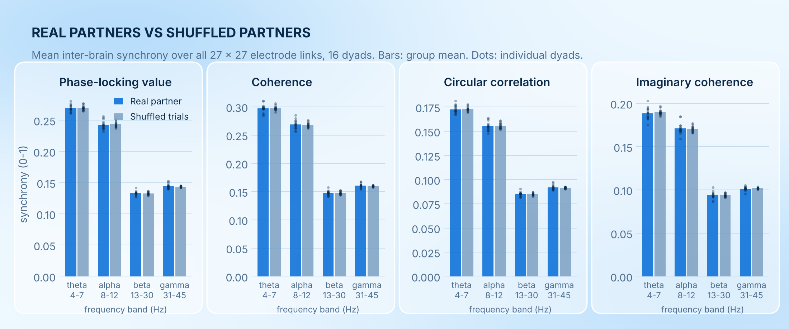
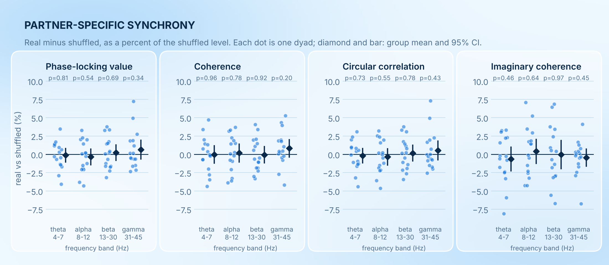
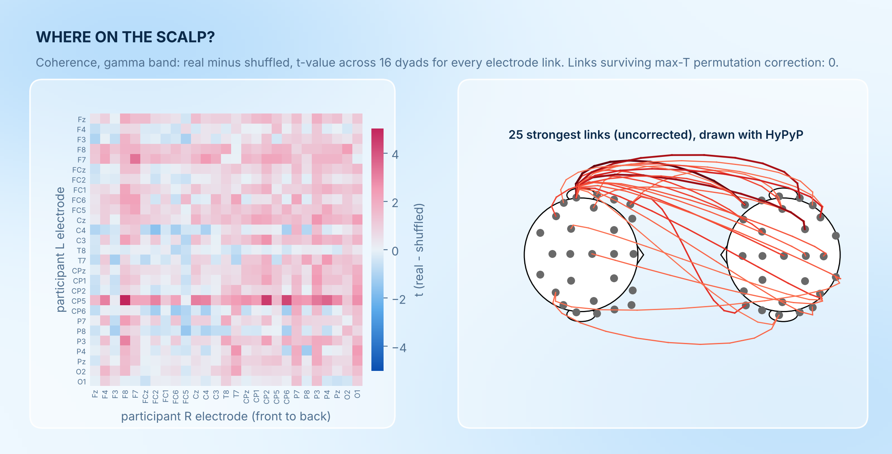
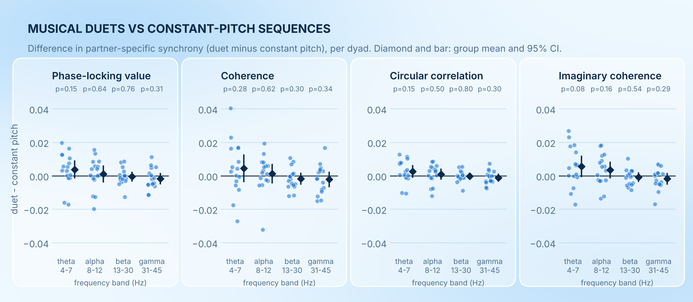

# Inter-brain synchrony in piano-style duets

An end-to-end hyperscanning analysis on open dual-EEG data: MNE-Python for preprocessing, HyPyP for inter-brain synchrony, and a trial-shuffle control to separate "these two brains are coupled" from "these two people are doing the same task".

**Short answer: no partner-specific synchrony was detectable.** Across 16 dyads, 4 synchrony measures and 4 frequency bands, synchrony between real partners was within about 1% of the level obtained when the same two people's data were re-paired across different trials. Nothing survived correction.

## Data

| | |
|---|---|
| Dataset | Joint agency EEG dataset, OpenNeuro [ds007471](https://openneuro.org/datasets/ds007471) v1.0.0 (Zhou, Zamm, Christensen, Rao & Loehr), CC0, doi:10.18112/openneuro.ds007471.v1.0.0 |
| Task | Two people side by side each produce one part of a 16-beat tone sequence on electronic music boxes. Half the blocks are musical duets (melody + accompaniment), half are constant-pitch sequences. |
| Recording | One BrainVision file per dyad: 64 channels at 1000 Hz, 32 per person (27 scalp EEG, 4 EOG, 1 mastoid), left-mastoid reference |
| Used here | 16 of the 32 dyads (sub-01 to sub-17, without sub-05, whose header has a different channel layout). 2,155 clean two-second windows in total. |

## Pipeline

| Step | Script | What happens |
|---|---|---|
| 0 | `code/00_download.py` | Fetches the raw `.eeg` files (about 4.2 GB) into `data/raw/` |
| 1 | `code/01_preprocess.py` | MNE-Python. Per person: linked-mastoid re-reference, 1 to 45 Hz FIR band-pass, resample to 250 Hz, 15-component ICA with automatic removal of eye components (correlation with the EOG channels). The first 8 s of every joint trial is cut into four 2 s windows; windows over 150 µV peak-to-peak are dropped. |
| 2 | `code/02_synchrony.py` | HyPyP. `analyses.compute_freq_bands` (band-pass + Hilbert) then `analyses.compute_sync` for PLV, coherence, circular correlation and imaginary coherence, between all 27 x 27 electrode links, in theta (4 to 7 Hz), alpha (8 to 12), beta (13 to 30) and gamma (31 to 45). |
| 3 | `code/03_stats.py` | Paired tests across dyads with FDR correction; electrode-level max-T permutation tests (`mne.stats.permutation_t_test`, `hypyp.stats.statsCond`). |
| 4 | `code/04_figures.py` | The four figures below. |

```bash
pip install -r requirements.txt
cd code
python 00_download.py && python 01_preprocess.py && python 02_synchrony.py && python 03_stats.py && python 04_figures.py
```

Step 2 takes about 6 minutes per dyad on a laptop core.

### The control that matters

Both players hear the same tones and tap at the same tempo, so their EEG will look "synchronised" even if their brains never exchange anything. To remove that, each window from player A was re-paired 20 times with player B's window from a **different trial of the same condition, at the same position in the trial**. Shuffled pairs share the task, the tempo, the people and the electrodes. Only the moment-to-moment interaction is broken. Real minus shuffled is the part of synchrony that is specific to playing together right now.

## Findings

### 1. Raw synchrony is not zero, but neither is the shuffled baseline



PLV sits around 0.27 in theta and 0.13 in beta. Those numbers mostly reflect how many cycles fit in a 2 s window (fewer cycles, higher chance-level phase locking), which is why the shuffled bars are just as tall. A raw PLV on its own says nothing about coupling.

### 2. Real partners are not more synchronised than shuffled partners



| Measure | Band | Real | Shuffled | Difference (95% CI) | t(15) | p |
|---|---|---|---|---|---|---|
| PLV | theta | 0.2695 | 0.2698 | -0.1% (-1.0 to 0.8) | -0.25 | 0.81 |
| PLV | alpha | 0.2426 | 0.2435 | -0.4% (-1.4 to 0.7) | -0.63 | 0.54 |
| PLV | beta | 0.1330 | 0.1327 | +0.2% (-0.8 to 1.3) | 0.41 | 0.69 |
| PLV | gamma | 0.1446 | 0.1437 | +0.6% (-0.6 to 1.9) | 0.99 | 0.34 |
| Coherence | theta | 0.2974 | 0.2975 | 0.0% (-1.2 to 1.2) | -0.05 | 0.96 |
| Coherence | alpha | 0.2686 | 0.2681 | +0.2% (-1.0 to 1.4) | 0.28 | 0.78 |
| Coherence | beta | 0.1474 | 0.1475 | -0.1% (-1.2 to 1.0) | -0.10 | 0.92 |
| Coherence | gamma | 0.1608 | 0.1595 | +0.8% (-0.4 to 2.0) | 1.33 | 0.20 |

Circular correlation and imaginary coherence show the same picture (all p > 0.4; full numbers in `derivatives/results.json`). Every FDR-corrected q is 0.97. In each test roughly half of the dyads fall on either side of zero. The confidence intervals are tight enough to say that any whole-scalp partner-specific effect is smaller than about 2% of the baseline level.

### 3. No electrode link stands out



Of the 729 electrode links per measure and band, none survives max-T permutation correction in any of the 16 maps (smallest corrected p = 0.058, gamma coherence, shown above). One same-site pair (P7 to P7, theta circular correlation) passes on its own, which is what you expect by chance from 16 maps of 27 sites. The map is a picture of noise, and the single bright row (CP5) is one noisy electrode rather than a network.

### 4. Duets vs constant pitch: no reliable difference



Theta-band synchrony trends higher in duets for all four measures (largest: imaginary coherence, p = 0.08 uncorrected), but nothing survives correction (all q > 0.5). With 16 dyads this is a hint to test on the full sample, not a result.

## What this does and does not mean

- It does **not** show that inter-brain synchrony does not exist. It shows that in this task, with sensor-level 2 s windows and a strict trial-shuffle baseline, there is nothing left once shared task structure is removed.
- The trial-shuffle baseline is deliberately conservative. Many published hyperscanning effects are measured against rest or against random pairs of strangers, which leaves shared stimulation in the "effect".
- Half the dataset was used. The other 15 usable dyads would roughly halve the variance of the group estimates.

## Limitations and choices worth knowing

- The README of the dataset says channels 1 to 32 are the left participant; the BrainVision headers label channels 1 to 32 `_R`. This analysis follows the headers. It does not change any inter-brain result, only which person is called L or R.
- sub-03 has no "test start" marker, so its last 40 joint trials were taken as the test trials.
- One dyad (sub-13) kept only 43 clean windows because one player's data were noisy.
- Bad windows were rejected by amplitude threshold rather than HyPyP's autoreject wrapper, and ICA components were chosen automatically, to keep the pipeline unattended.
- Analysis is at sensor level with a mastoid reference. Volume conduction is not a concern between two separate heads, but sensor-level phase is still a blurred view of sources.
- Solo trials (one person plays, the other listens) are in the data and unused. They would make a good second control.

## Next steps

1. Run the remaining dyads (change `PAIRS` in `code/config.py`).
2. Relate trial-by-trial synchrony to the behavioural asynchrony and joint-agency ratings in `data/ds007471/sub-*/beh/`.
3. Lock the analysis to tone onsets instead of fixed windows, since the interaction lives at the beat level.

## Layout

```
code/          pipeline scripts and config
data/ds007471  events, behaviour and metadata from OpenNeuro (raw .eeg goes in data/raw)
derivatives/   results.json (all statistics), group_maps.npz (electrode-level maps)
figures/       fig1 to fig4
report.html    the same findings as a styled page
```
